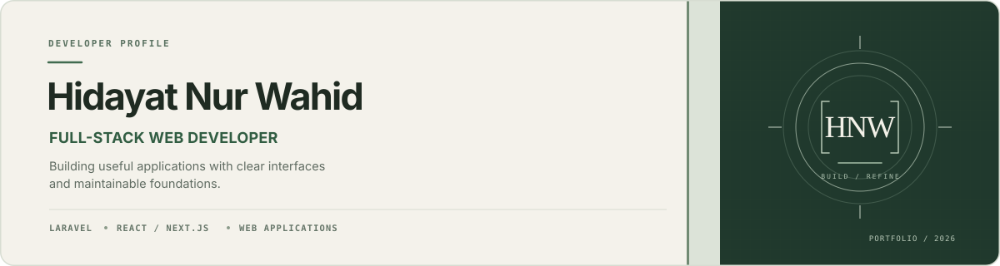
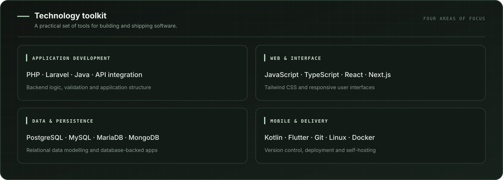

  

  

    <a href="https://github.com/WahidYazan?tab=repositories">PROJECTS</a>
    &nbsp;&nbsp;·&nbsp;&nbsp;
    <a href="mailto:goakmal3@gmail.com">EMAIL</a>
    &nbsp;&nbsp;·&nbsp;&nbsp;
    <a href="https://www.instagram.com/yazzan_sz/">INSTAGRAM</a>
  

## Profile

I'm **Hidayat Nur Wahid**, a developer focused on web applications, primarily using **Laravel, React, and Next.js**. I enjoy building database-backed features and working through the full development process—from application logic and data modelling to interface design and deployment.

My goal is to make software that is useful, clear to navigate, and straightforward to maintain. I prefer practical solutions, readable code, and thoughtful details over complexity for its own sake.

## Selected work

### [01 — FlowBill](https://github.com/WahidYazan/Flowbill)

An invoicing application for freelancers and small businesses, with customer management, invoice workflows, multi-currency support, and revenue analytics.

**Built with:** PHP · Laravel · Alpine.js · Tailwind CSS · SQLite

[View source code →](https://github.com/WahidYazan/Flowbill)

---

### [02 — LMS TKA / PPLG](https://github.com/WahidYazan/LMS-TKA-JURUSAN-PPLG-2)

A learning-platform project for the TKA/PPLG context, built as a modern web application and published online.

**Built with:** Next.js · TypeScript

[Live site →](https://lms-tka-jurusan-pplg-2.vercel.app) · [Source code →](https://github.com/WahidYazan/LMS-TKA-JURUSAN-PPLG-2)

---

### [03 — Coding from Zero](https://github.com/WahidYazan/Platform-Belajar-Coding-Dari-Nol)

A project centred on making programming easier to approach, starting with the fundamentals and a modern web development stack.

**Built with:** Next.js · TypeScript

[View source code →](https://github.com/WahidYazan/Platform-Belajar-Coding-Dari-Nol)

## Technical focus

  

## How I approach projects

- **Understand the problem.** Start with the user's needs and the simplest solution that works.
- **Build with care.** Keep responsibilities clear, validate input, and consider how features fail—not only how they succeed.
- **Refine the experience.** Pay attention to responsive layouts, readability, accessibility, and consistent interactions.
- **Keep learning.** Use each project to improve technical judgement and delivery.

Outside application development, I'm interested in Linux hosting, deployment workflows, and the infrastructure that keeps web services running.

## Contact

For project discussions, feedback, or collaboration:

- **Email:** [goakmal3@gmail.com](mailto:goakmal3@gmail.com)
- **Instagram:** [@yazzan_sz](https://www.instagram.com/yazzan_sz/)
- **GitHub:** [@WahidYazan](https://github.com/WahidYazan)

  Built with intention. Improved through practice.

