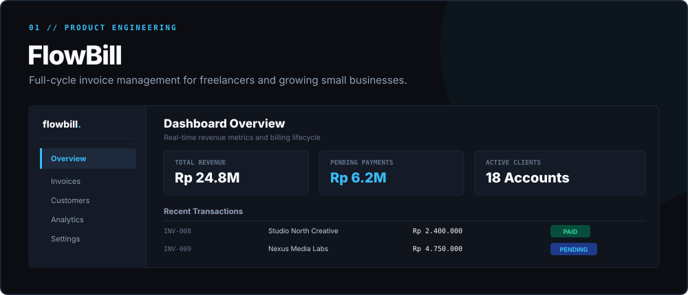
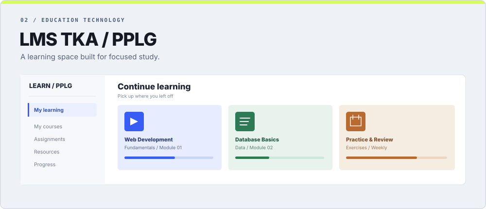
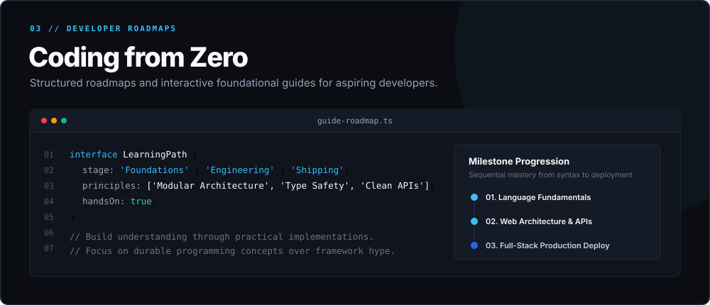
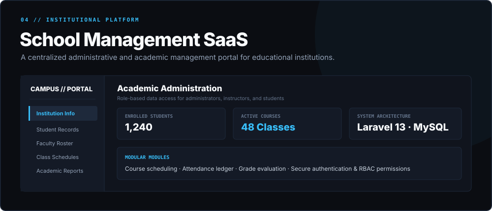
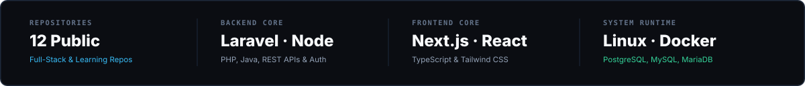

<div align="center">

  <!-- Signature Hero Banner -->
  <a href="https://github.com/WahidYazan">
    
  </a>

  <br />

  <!-- Quick Navigation & Verified Channels -->
  <p align="center">
    <a href="https://github.com/WahidYazan">
      
    </a>
    &nbsp;
    <a href="mailto:goakmal3@gmail.com">
      
    </a>
    &nbsp;
    <a href="https://discord.gg/P2ttcrbxB">
      
    </a>
    &nbsp;
    <a href="https://www.instagram.com/yazzan_sz/">
      
    </a>
  </p>

</div>

---

### 👤 About Me

I am **Hidayat Nur Wahid** (also known as **Yazan**), a **Full-Stack Developer** focused on building dependable web applications, structured backend services, and clean, responsive user interfaces.

My engineering workflow spans the complete software lifecycle:
- **Backend Architecture:** Designing relational schemas, writing modular application logic in **Laravel** and **Node.js**, and building secure REST APIs.
- **Frontend Development:** Crafting modern, accessible, and fast client-side applications with **Next.js**, **React**, **TypeScript**, and **Tailwind CSS**.
- **Data & Persistence:** Modeling normalized relational databases with **PostgreSQL**, **MySQL**, and **MariaDB**, along with document storage using **MongoDB**.
- **System Environments:** Managing **Linux** systems, configuring **Docker** containers, and hosting self-managed server setups to understand application deployment end-to-end.

I prioritize writing clean, maintainable code, solving real-world operational problems, and learning continuously by shipping practical software.

---

### 🛠️ Technical Matrix

<div align="center">
  
</div>

<br />

| Domain | Verified Stack & Practical Technologies |
| :--- | :--- |
| **Frontend** | `JavaScript` · `TypeScript` · `React` · `Next.js` · `Tailwind CSS` · `Alpine.js` |
| **Backend** | `PHP` · `Laravel 13` · `Node.js` · `Java` · `REST API Design` · `Authentication` |
| **Mobile Development** | `Kotlin` · `Flutter` |
| **Databases** | `PostgreSQL` · `MySQL` · `MariaDB` · `MongoDB` · `SQLite` |
| **Tools & Infrastructure** | `Git` · `GitHub` · `Linux (CachyOS / Ubuntu)` · `Docker` · `Proxmox VE` |

---

### 📌 Featured Projects

Verified open-source repositories and applications engineered with modern full-stack workflows:

<br />

<table>
  <tr>
    <td width="50%" valign="top">
      <a href="https://github.com/WahidYazan/Flowbill">
        
      </a>
      <h3><a href="https://github.com/WahidYazan/Flowbill">🧾 FlowBill — Invoicing Platform</a></h3>
      <p>A streamlined invoicing and billing platform engineered for freelancers and small businesses. Facilitates client ledger management, payment tracking, automated total calculations, and revenue analytics.</p>
      <p><sub><strong>Stack:</strong> <code>Laravel 13</code> · <code>PHP</code> · <code>Alpine.js</code> · <code>Tailwind CSS</code> · <code>SQLite / MySQL</code></sub></p>
      <p>
        <a href="https://github.com/WahidYazan/Flowbill"><strong>Explore Repository ↗</strong></a>
      </p>
    </td>
    <td width="50%" valign="top">
      <a href="https://github.com/WahidYazan/LMS-TKA-JURUSAN-PPLG-2">
        
      </a>
      <h3><a href="https://github.com/WahidYazan/LMS-TKA-JURUSAN-PPLG-2">🎓 LMS TKA — PPLG</a></h3>
      <p>A structured learning management system built for software engineering (PPLG) students. Features modular course outlines, curriculum progress tracking, assignments, and an intuitive responsive user experience.</p>
      <p><sub><strong>Stack:</strong> <code>Next.js 16</code> · <code>React 19</code> · <code>TypeScript</code> · <code>Tailwind CSS v4</code></sub></p>
      <p>
        <a href="https://github.com/WahidYazan/LMS-TKA-JURUSAN-PPLG-2"><strong>Explore Repository ↗</strong></a>
      </p>
    </td>
  </tr>
  <tr>
    <td width="50%" valign="top">
      <a href="https://github.com/WahidYazan/Platform-Belajar-Coding-Dari-Nol">
        
      </a>
      <h3><a href="https://github.com/WahidYazan/Platform-Belajar-Coding-Dari-Nol">🚀 Coding from Zero (Platform Belajar)</a></h3>
      <p>An interactive developer roadmap platform that organizes programming fundamentals into sequential, digestible concepts to guide beginners through their initial learning curves.</p>
      <p><sub><strong>Stack:</strong> <code>Next.js 16</code> · <code>React 19</code> · <code>TypeScript</code> · <code>Tailwind CSS</code></sub></p>
      <p>
        <a href="https://github.com/WahidYazan/Platform-Belajar-Coding-Dari-Nol"><strong>Explore Repository ↗</strong></a>
      </p>
    </td>
    <td width="50%" valign="top">
      <a href="https://github.com/WahidYazan/School-Management-Saas">
        
      </a>
      <h3><a href="https://github.com/WahidYazan/School-Management-Saas">🏫 School Management SaaS</a></h3>
      <p>A centralized academic administration system managing student records, faculty rosters, course schedules, and role-based permissions with a clean modular Laravel backend.</p>
      <p><sub><strong>Stack:</strong> <code>Laravel 13</code> · <code>PHP</code> · <code>MySQL</code> · <code>Tailwind CSS</code></sub></p>
      <p>
        <a href="https://github.com/WahidYazan/School-Management-Saas"><strong>Explore Repository ↗</strong></a>
      </p>
    </td>
  </tr>
</table>

---

### 📊 Engineering Activity & Metrics

<div align="center">
  
</div>

<br />

<div align="center">
  <a href="https://github.com/WahidYazan">
    
  </a>
</div>

---

### ⚙️ Development Philosophy

```
  01 / UNDERSTAND      Model entity relationships and validate data contracts before writing UI.
  02 / MODULARIZE      Decouple routing, controllers, business rules, and presentation layers.
  03 / OPTIMIZE        Refine client bundle sizes, query indexes, and mobile viewport accessibility.
  04 / DELIVER         Automate containerized builds and deploy on stable Linux runtime environments.
```

- **Maintainability Over Cleverness:** Readable, well-structured code is easier to debug, review, and extend than obscure shortcuts.
- **End-to-End Ownership:** Understanding both database constraints and frontend layout prevents misaligned API contracts.
- **Learning Through Real Shipping:** Real engineering intuition is developed by resolving real build failures, schema migrations, and server bottlenecks.

---

### 📬 Connect & Community

Feel free to reach out for project collaboration, technical discussions, or community inquiries:

| Channel | Destination / Handle | Action |
| :--- | :--- | :--- |
| **Email** | `goakmal3@gmail.com` | <a href="mailto:goakmal3@gmail.com"><strong>Send Email ↗</strong></a> |
| **Discord Community** | `discord.gg/P2ttcrbxB` | <a href="https://discord.gg/P2ttcrbxB"><strong>Join Server ↗</strong></a> |
| **Discord Direct** | `yazanpet` | Contact via Discord |
| **Instagram** | `@yazzan_sz` | <a href="https://www.instagram.com/yazzan_sz/"><strong>View Profile ↗</strong></a> |
| **GitHub** | `@WahidYazan` | <a href="https://github.com/WahidYazan"><strong>Follow Repositories ↗</strong></a> |

---

<div align="center">
  <sub><strong>Hidayat Nur Wahid</strong> · Engineered with precision, focus, and continuous curiosity.</sub>
</div>
