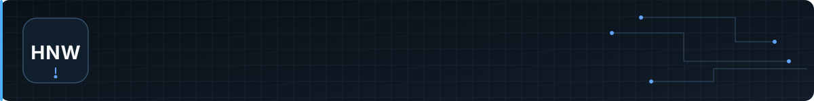

  

<h1 align="center">Hidayat Nur Wahid</h1>

  <strong>Full-Stack Developer</strong> 
  Building useful web applications, clear interfaces, and dependable backend systems.

  <a href="#about">About</a> &nbsp;·&nbsp;
  <a href="#engineering-toolkit">Toolkit</a> &nbsp;·&nbsp;
  <a href="#selected-projects">Projects</a> &nbsp;·&nbsp;
  <a href="#engineering-principles">Principles</a> &nbsp;·&nbsp;
  <a href="#contact">Contact</a>

---

## About

I'm a developer who enjoys building software from end to end—from shaping a clear user interface to implementing application logic and working with data. I learn by building real projects, reading code, and improving each iteration. My current focus is full-stack web development, alongside an ongoing interest in mobile development and the systems behind reliable applications.

## Engineering toolkit

**Frontend** · JavaScript · TypeScript · React · Next.js · Tailwind CSS  
**Backend** · PHP · Laravel · Node.js · Java  
**Mobile** · Kotlin · Flutter  
**Databases** · PostgreSQL · MySQL · MariaDB · MongoDB  
**Tools & systems** · Git · GitHub · Linux · Docker

I expand this toolkit through hands-on projects and choose tools based on the problem they need to solve.

## Selected projects

### [FlowBill](https://github.com/WahidYazan/Flowbill)

An invoicing application for freelancers and small businesses, with customer management, invoice status tracking, public invoice pages, multi-currency support, and revenue analytics.

`Laravel 13` · `PHP 8.4+` · `Alpine.js` · `Tailwind CSS 4` · `SQLite`

### [LMS TKA — PPLG](https://github.com/WahidYazan/LMS-TKA-JURUSAN-PPLG-2)

An interactive learning resource for the PPLG program, with structured study modules, topic search and filters, and quiz-related learning flows.

`Next.js` · `React` · `TypeScript` · `Supabase` · `Tailwind CSS`

## Engineering principles

- **Make code maintainable.** Prefer clear names, small responsibilities, and predictable application structure.
- **Build for real use.** Consider accessibility, edge cases, performance, and the needs of the people using the product.
- **Understand the whole system.** Connect the interface, backend logic, and data model instead of treating them as isolated parts.
- **Learn by shipping.** Build, review what works, and improve the next iteration.

## GitHub activity

Explore my current work directly on GitHub:

[Public repositories](https://github.com/WahidYazan?tab=repositories) · [Profile and contribution activity](https://github.com/WahidYazan)

## Contact

  <a href="mailto:goakmal3@gmail.com">Email</a> &nbsp;·&nbsp;
  <a href="https://www.instagram.com/yazzan_sz/">Instagram</a> &nbsp;·&nbsp;
  <a href="https://discord.gg/P2ttcrbxB">Discord Community</a>

**Discord username:** `yazanpet`

---

  Hidayat Nur Wahid · Full-Stack Developer 
  Build useful things. Understand the system. Keep improving.

